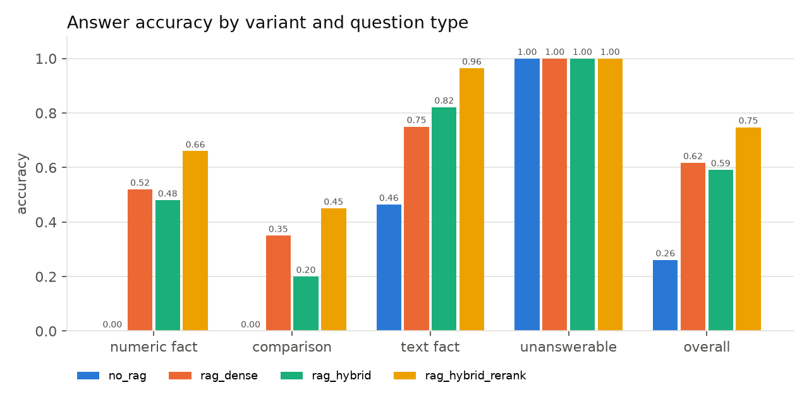

# D2 — Agente RAG especialista em documentos financeiros (10-K / 10-Q)

Trabalho do entregável D2 de *Natural Language Interaction* (Mestrado em IA, FCTUC).
É um agente de *Retrieval-Augmented Generation* sobre os relatórios oficiais que empresas
cotadas nos EUA entregam à SEC. Inclui uma comparação quantitativa da qualidade das respostas
**com e sem RAG**.

> **Aviso:** o agente responde apenas a perguntas factuais e analíticas sobre o conteúdo dos
> documentos. **Não dá aconselhamento financeiro nem recomendações de investimento.** Pedidos
> desse tipo são recusados por um *guardrail*.

Tudo é open source e corre localmente, sem APIs pagas:

| Componente | Escolha |
|---|---|
| LLM gerador | `llama3.1:8b` via Ollama (dados de treino até dez/2023, anteriores a todos os documentos, que são de 2025–2026) |
| LLM juiz | `qwen2.5:7b` via Ollama (família diferente do gerador, para reduzir o viés de auto-preferência) |
| Embeddings | `BAAI/bge-base-en-v1.5` (sentence-transformers); `BAAI/bge-m3` na experiência com chunks longos |
| Base vetorial | ChromaDB persistente (`data/index/chroma`) |
| Recuperação lexical | BM25 Okapi (`rank_bm25`) |
| Reranker | `BAAI/bge-reranker-base` (cross-encoder) |
| Avaliação | pandas, numpy, matplotlib |

## Corpus

Seis empresas (`config.yaml`): **AAPL, MSFT, NVDA, TSLA, JPM, KO**. Por empresa usamos o último
10-K e os últimos 4 10-Q, todos com data de filing ≥ 2025-01-01. São **30 filings**, com filings
entre 2025-05 e 2026-08.
Os factos XBRL (`companyfacts`) de cada empresa são descarregados como *ground truth* numérico
e **não são indexados**.

## Arquitetura

```
             ┌──────────────── data_collection ────────────────┐
 SEC EDGAR → │ ticker→CIK → submissions → 10-K/10-Q HTML       │ → data/raw/filings
             │ HTML→texto (tabelas "a | b") → secções por Item │ → data/processed/<T>/<acc>.json
             │ XBRL companyfacts (ground truth, não indexado)  │ → data/raw/xbrl/<T>.json
             └────────────────────────────────── manifest.json ┘
                                   │
             ┌──────────────── indexing ───────────────────────┐
             │ chunks por secção (tokens do embedder, overlap) │
             │ + cabeçalho contextual [ticker|form|período|Item]│
             │ → ChromaDB (bge)   → BM25                        │ → data/index/<config>/
             └──────────────────────────────────────────────────┘
                                   │
 pergunta → guardrail ─(conselho de investimento)→ recusa
               │
               ├─ no_rag ──────────────────────────────────────────────┐
               ├─ rag_dense:   top-k densa                             │
               ├─ rag_hybrid:  densa + BM25 → RRF                      ├→ LLM (mesmo prompt de sistema) → resposta + fontes [n]
               └─ rag_hybrid_rerank: híbrida (30 cand.) → cross-encoder│
                  (filtro por ticker se a pergunta nomeia empresas)    ┘
```

```
config.yaml            empresas, modelos, chunking, k, User-Agent SEC
common/                config + cliente HTTP da SEC (User-Agent, ≤8 req/s, backoff, cache)
data_collection/       edgar.py, extract_sections.py, xbrl.py, collect.py
indexing/              chunking.py, embeddings.py, bm25.py, store.py, build_index.py
agent/                 retrievers.py, prompts.py, guardrail.py, entities.py, llm.py, rag_agent.py, cli.py, app_gradio.py
evaluation/            xbrl_questions.py, generate_questions.py, manual_questions.jsonl, guardrail_tests.jsonl,
                       export_validation_sample.py, metrics.py, judge.py, prompts/judge.txt,
                       run_all.py, retrieval_eval.py, report.py
tests/                 smoke_test.py (1 empresa, 5 perguntas), test_units.py
results/               results.csv, summary.md, figures/, runs/<run>/
```

## Como correr

Pré-requisitos: macOS/Linux, Python 3.13 (o torch e o chromadb ainda não suportam bem o 3.14) e
[Ollama](https://ollama.com).

```bash
brew install ollama && brew services start ollama
make install          # cria o .venv e instala requirements.txt
make models           # ollama pull llama3.1:8b / qwen2.5:7b
# Preencher sec.user_agent em config.yaml ("Nome email"), exigido pela SEC

make collect          # Fase 1  (~1 min; tudo fica em cache)
make index            # Fase 2  (~2 min no M1 Max)
make questions        # Fase 4.1 → evaluation/questions.jsonl + results/validation_sample.csv
make evaluate         # Fase 4.2–4.3 → results/results.csv   (~1h30 no M1 Max)
make experiments      # chunk size / k (índices extra + recuperação + subconjunto de 40 perguntas)
make report           # Fase 4.4 → results/summary.md + results/figures/
# ou tudo de uma vez: make all

make smoke            # teste rápido end-to-end: 1 empresa (AAPL), 5 perguntas
make test             # testes unitários (sem rede nem modelos)
make cli              # agente interativo;  python -m agent.cli --variant no_rag -q "..."
make app              # interface Gradio em http://127.0.0.1:7860
```

## Decisões de design

**Extração por secções (implementação própria, e não o edgar-crawler).** O edgar-crawler não é
um pacote pip, tem configuração e estrutura de pastas próprias, e o suporte a 10-Q é mais fraco
do que a 10-K. Como só precisamos dos filings mais recentes de 6 empresas, um extrator pequeno
e auditável (`data_collection/extract_sections.py`) é mais fácil de controlar:
1. HTML → texto: remove o cabeçalho iXBRL oculto e converte tabelas em linhas `célula | célula`,
   voltando a juntar `$`, `)` e `%`, que a SEC coloca em células separadas. Assim os números
   ficam junto dos rótulos.
2. Cabeçalhos `PART I/II` e `Item 1A.` são detetados por regex ancorada ao início da linha.
3. O índice do documento também contém todos os Items, por isso fica o **segmento mais longo** de
   cada Item. Cabeçalhos repetidos consecutivos são fundidos: o Microsoft repete
   "PART I / Item 1" em todas as páginas.
4. Validação e *fallback*: se faltarem Items-chave, ou se um Item engolir mais de 80% do
   documento, o documento é dividido pelos seus próprios títulos. Isto acontece com o
   **JPMorgan**, cujo 10-K está organizado como relatório anual com um índice de
   correspondência. Essas secções aparecem como `Report: <título>`.

Outros detalhes da recolha: o `recent` da API `submissions` só tem cerca de 1000 filings, e o
JPM publica prospetos diariamente, por isso as páginas antigas também são lidas. O cliente
respeita as regras da SEC: User-Agent, 8 pedidos/s, *backoff* exponencial em 429/403/5xx e cache
em disco, para nunca descarregar o mesmo URL duas vezes.

**Chunking.** Cada chunk tem 512 tokens com 64 de overlap, contados com o tokenizer do embedder.
Assim o chunk cabe inteiro no limite de 512 do bge; chunks de 800 seriam truncados
silenciosamente. Os chunks nunca atravessam secções. O texto de cada chunk é uma *substring*
exata da secção, recuperada pelos *offsets* do tokenizer. Cada chunk leva à frente um
**cabeçalho contextual**, por exemplo `[AAPL | Apple Inc. | Form 10-Q for the period ended
2025-06-28 | Part I - Item 2 (MD&A)]`. Sem isto, perguntas como "…no trimestre terminado em 28
de junho de 2025" não têm onde "agarrar" no corpo do texto. Os metadados guardados são ticker,
empresa, form, filing_date, report_date, accession, secção, título e índice do chunk.
A re-indexação é idempotente: cada configuração
`(chunk_size, overlap, embedder, corpus)` tem coleção e pasta próprias e só é reconstruída
com `--force`.

**Variantes e prompt.** As quatro variantes usam o **mesmo LLM** (temperatura 0, seed fixa) e o
**mesmo prompt de sistema** (`agent/prompts.py`). A diferença está só na mensagem do utilizador:
as variantes RAG recebem um bloco `CONTEXT` com 5 excertos numerados e a instrução para
responder só com base nele, citar `[n]` e responder exatamente *"I could not find this
information in the documents."* quando a resposta não está lá. O `no_rag` recebe a instrução
equivalente para o seu próprio conhecimento.
Na variante híbrida, a fusão usa **Reciprocal Rank Fusion** (k=60) sobre os 30 melhores
candidatos de cada recuperador. O reranker reordena esses candidatos fundidos.
**Filtro por metadados:** se a pergunta menciona empresas (por ticker ou nome, por exemplo
"Coca-Cola" → KO), a pesquisa densa e a BM25 ficam restritas a esses tickers.

**Guardrail** (`agent/guardrail.py`): regex em inglês e português para pedidos de
recomendação ("should I buy", "price target", "vale a pena investir", "devo comprar"…), mais um
classificador opcional por prompt (`agent.guardrail_use_llm`). Perguntas factuais que falam de
ações ("quantas ações a Apple recomprou?") não são bloqueadas. A resposta de recusa sai na
língua da pergunta.

## Avaliação

### Perguntas (`evaluation/questions.jsonl`, 115 no total)

| Tipo | N | Origem | Como é pontuada |
|---|---|---|---|
| `numeric_fact` | 50 (43%) | **geradas automaticamente do XBRL** | valor extraído da resposta vs XBRL, 1% de erro relativo |
| `comparison` | 20 | XBRL: 8 YoY no mesmo 10-Q, 6 QoQ entre 10-Qs, 6 entre empresas | variação (valor ou %) no caso numérico; juiz ≥ 4 em "qual empresa" |
| `text_fact` | 28 | escritas à mão a partir dos filings, com evidência verificada | juiz ≥ 4 (valor numérico quando existe), mais token-F1/EM |
| `unanswerable` | 17 (15%) | escritas à mão: empresa fora do corpus, período futuro, dado não divulgado | abstenção correta |

**Geração a partir do XBRL** (`evaluation/xbrl_questions.py`): para cada filing usamos os
factos com `accn` igual ao do filing e `end` igual ao período do relatório. A duração
(3/6/9/12 meses) é derivada de `start`/`end` e dá frases como "three months ended June 28,
2025" ou "fiscal year ended…". Cada métrica tem tags alternativas por ordem de prioridade
(`RevenuesNetOfInterestExpense` → `Revenues` → `RevenueFromContractWithCustomerExcludingAssessedTax`
→ `SalesRevenueNet`). Se nenhuma existir, a pergunta é descartada. A amostragem é estratificada
por empresa e métrica (seed 42). `make validation-sample` exporta 30 perguntas automáticas para
`results/validation_sample.csv`, com o URL do filing e as colunas `valid`/`notes` para validação
manual.

### Métricas

- **Recuperação** (variantes RAG): P@k, R@k, F@k e MRR para k ∈ {1,3,5,10}. Um chunk é
  **relevante** se pertence ao filing de referência (accession) e contém a evidência de
  referência: o valor XBRL tal como aparece impresso (por exemplo `94,036`) ou a frase-chave
  nas perguntas textuais.
- **Numéricas:** extração de todos os números da resposta com normalização de unidades
  (`million/billion/thousand`, `mil milhões`, vírgula decimal portuguesa, negativos entre
  parênteses). Números "nus" ≥ 100 também são testados como milhões ou milhares, porque as
  tabelas estão "in millions". O critério é erro relativo ≤ 1%.
- **Textuais:** token-F1 e *exact match* ao estilo SQuAD, mais **LLM-as-judge**
  (`evaluation/prompts/judge.txt`) com dois critérios de 1 a 5: *correctness* face à referência e
  *faithfulness* face ao contexto recuperado. O juiz também avalia as numéricas, e o acordo
  juiz/verificação determinística (kappa de Cohen) é reportado como validação do juiz.
- **Sem resposta:** taxa de abstenção correta vs alucinação. Reportamos também a **falsa
  abstenção**, isto é, dizer "não encontrei" quando a resposta existe.
- **Latência** média e mediana (recuperação e geração) por variante.
- **Significância:** *bootstrap* emparelhado sobre as perguntas (2000 reamostragens), com
  IC95% da diferença de accuracy entre cada variante RAG e o `no_rag`, e entre variantes RAG.
- **Guardrail:** precisão e recall em 24 prompts (EN/PT).

### Experiência adicional

- **Chunk size / embedder (só recuperação, todas as perguntas):** 256/bge-base, 512/bge-base,
  512/bge-m3 e 1024/bge-m3. O bge-base só lê 512 tokens, por isso os chunks de 1024 usam o
  bge-m3. A configuração 512/bge-m3 é o controlo que separa o efeito do tamanho do efeito do
  modelo.
- **Ao nível da resposta** (`rag_hybrid_rerank`, subconjunto estratificado de 40 perguntas):
  chunk 256/512/1024 e k ∈ {3, 5, 10}.

## Resultados

Ver [`results/summary.md`](results/summary.md) (tabelas completas, bootstrap, exemplos) e
`results/figures/`.

### Accuracy por variante e tipo de pergunta (115 perguntas, índice 512/bge-base, k=5)

| Variante | numeric_fact (50) | comparison (20) | text_fact (28) | unanswerable (17) | **global** | latência média |
|---|---|---|---|---|---|---|
| `no_rag` | 0,00 | 0,00 | 0,46 | 1,00 | 0,26 | 0,4 s |
| `rag_dense` | 0,52 | 0,35 | 0,75 | 1,00 | 0,62 | 11,3 s |
| `rag_hybrid` | 0,48 | 0,20 | 0,82 | 1,00 | 0,59 | 9,9 s |
| `rag_hybrid_rerank` | **0,66** | **0,45** | **0,96** | 1,00 | **0,75** | 11,9 s |



**Principais conclusões**

- **RAG vs sem RAG.** As três variantes RAG são significativamente melhores do que o `no_rag`
  (bootstrap emparelhado, IC95% exclui 0). A melhor, `rag_hybrid_rerank`, ganha **+0,49** de accuracy
  global (IC95% [0,40; 0,58]). Sem RAG o modelo não acerta nenhum valor numérico: os filings são
  posteriores ao seu treino. Acerta 46% das textuais porque sabe de memória factos estáveis
  (sede, auditor, segmentos).
- **O `no_rag` não alucina, abstém-se.** Diz "não encontrei" em 90% das perguntas com resposta.
  Com RAG, esta falsa abstenção desce para 14% (`rag_hybrid_rerank`).
- **O reranker é o componente que mais conta.** `rag_hybrid_rerank` supera a densa (+0,13) e a
  híbrida (+0,16), com diferenças significativas. A híbrida sem reranker não é significativamente
  diferente da densa (−0,03).
- **Recuperação.** MRR 0,39 (densa) → 0,43 (híbrida) → 0,51 (híbrida + reranker); R@10 0,38 → 0,44
  → 0,56. Os valores absolutos de recall são baixos porque o mesmo valor aparece em vários chunks
  (tabelas, MD&A, overlap), e todos contam como relevantes.
- **Perguntas sem resposta.** Todas as variantes se abstêm corretamente nas 17 (100%), por isso este
  conjunto não distingue as variantes. Seria preciso um conjunto mais "tentador".
- **Juiz.** Nas 300 respostas que têm verificação numérica, o juiz concorda com ela em 87%
  (kappa de Cohen 0,74). Os 39 desacordos são todos casos em que o juiz aceitou uma resposta que a
  verificação numérica rejeitou: o juiz é mais leniente.
- **Guardrail.** 24/24 prompts de teste corretos (12 pedidos de conselho, 12 perguntas factuais).

### Experiência adicional: chunk size, embedder e k

Só recuperação, com as 98 perguntas que têm fonte de referência (MRR):

| Índice | BM25 | densa | híbrida | híbrida + reranker |
|---|---|---|---|---|
| 256 / bge-base | 0,43 | 0,37 | 0,47 | 0,53 |
| 512 / bge-base (defeito) | 0,40 | 0,39 | 0,43 | 0,51 |
| 512 / bge-m3 | 0,41 | 0,40 | 0,45 | 0,52 |
| 1024 / bge-m3 | 0,51 | 0,41 | 0,51 | 0,53 |

Ao nível da resposta (`rag_hybrid_rerank`, o mesmo subconjunto estratificado de 40 perguntas):

| Configuração | accuracy | numeric_fact | comparison |
|---|---|---|---|
| chunk 256, k=5 | 0,63 | 0,47 | 0,14 |
| chunk 512, k=5 (defeito) | 0,70 | 0,59 | 0,29 |
| chunk 1024 (bge-m3), k=5 | 0,58 | 0,53 | 0,14 |
| chunk 512, k=3 | 0,63 | 0,41 | 0,29 |
| chunk 512, k=10 | **0,85** | **0,82** | **0,57** |

- Com o reranker, o tamanho do chunk quase não muda a recuperação (MRR 0,51–0,53). Sem reranker,
  os chunks de 1024 ajudam sobretudo o BM25.
- Na resposta, 512 é o melhor tamanho. Os chunks de 1024 são truncados pelo reranker (512 tokens)
  e dão contextos mais longos, com mais ruído, ao LLM de 8B.
- **O k é o parâmetro com mais impacto:** passar de 5 para 10 excertos sobe a accuracy de 0,70 para
  0,85, sobretudo nas numéricas e nas comparações, que muitas vezes precisam de dois valores.
  O custo é mais latência e um contexto maior. Com n=40, estas diferenças são indicativas.
- Nota: as corridas `cs1024`, `k3` e `k10` usaram embeddings e reranker no CPU (para não disputar
  a GPU com o Ollama), por isso as suas latências em `summary.md` não são comparáveis com as outras.

## Limitações conhecidas

- **Contaminação do treino:** o gerador foi escolhido com *cutoff* anterior a 2024, e todos os
  filings são de 2025–2026, por isso o `no_rag` não pode "saber" as respostas. Mesmo assim,
  factos estáveis (sede, segmentos, auditor) podem estar na memória do modelo, o que favorece o
  `no_rag` nas perguntas textuais.
- **Juiz LLM de 7B:** é mais fraco do que um humano, tende a ser leniente com respostas parciais
  e pode ser influenciado pelo formato. Mitigámos isto com a rubrica em ficheiro, JSON forçado,
  um modelo de outra família e a validação contra as métricas determinísticas.
- **Tabelas:** são linearizadas em `a | b | c`. Tabelas com muitas colunas (por exemplo, 3 anos
  × segmentos) perdem a associação coluna/cabeçalho quando o chunk as corta. Esta é a principal
  fonte de erros numéricos (período ou coluna errados).
- **Relevância por evidência:** um chunk que contém o valor certo noutro contexto conta como
  relevante, e um chunk que parafraseia o valor (por exemplo "$94.0 billion") não conta. As
  métricas de recuperação são por isso aproximadas.
- **Extração do JPM:** usa o *fallback* por títulos, por isso as secções não correspondem aos
  Items oficiais.
- **Perguntas manuais:** as textuais e as sem resposta foram escritas por nós. O guardrail foi
  testado com um conjunto escrito em conjunto com as regras, e é otimista.
- **Perguntas sobre XBRL:** os rótulos das perguntas ("gross margin") podem não coincidir com a
  terminologia de cada empresa. A amostra de validação manual serve para detetar estes casos.
- **Latência:** foi medida num MacBook M1 Max (32 GB) com Ollama/Metal. A variante com reranker
  acrescenta cerca de 1 s de recuperação por pergunta. A geração (cerca de 10 s) domina a latência.
- O agente **não dá aconselhamento financeiro**, e as respostas não devem ser usadas como tal.
