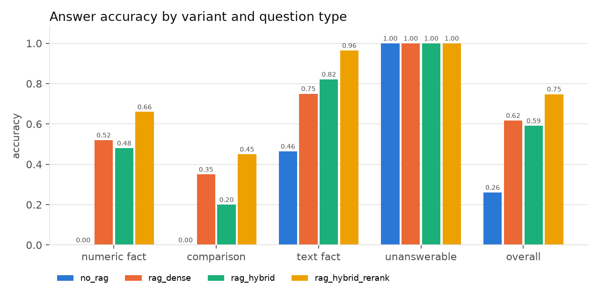
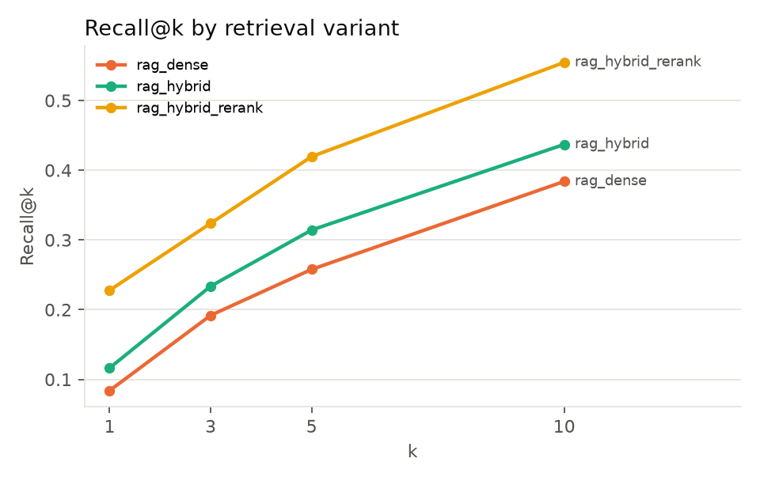
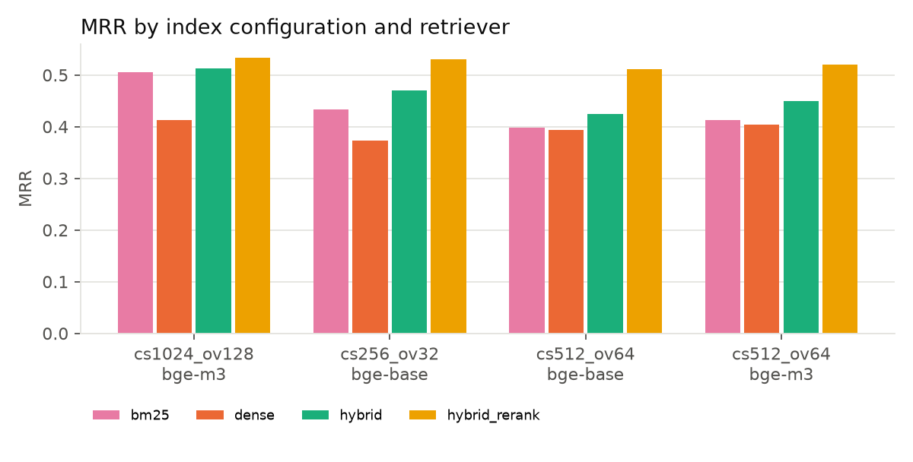

# Evaluation summary: RAG vs no-RAG on SEC filings

Generator `llama3.1:8b`, judge `qwen2.5:7b`, index `cs512_ov64_embedding`, top-k=5, 115 questions, companies AAPL, MSFT, NVDA, TSLA, JPM, KO.

## 1. Answer accuracy by variant and question type

`correct` = numeric match within tolerance (numeric facts, numeric comparisons, numeric text facts), LLM-judge correctness >= 4 (other text facts, 'which company' comparisons), correct abstention (unanswerable).

Questions per type: numeric_fact=50, comparison=20, text_fact=28, unanswerable=17.

| variant           |   numeric_fact |   comparison |   text_fact |   unanswerable |   overall |
|:------------------|---------------:|-------------:|------------:|---------------:|----------:|
| no_rag            |          0.000 |        0.000 |       0.464 |          1.000 |     0.261 |
| rag_dense         |          0.520 |        0.350 |       0.750 |          1.000 |     0.617 |
| rag_hybrid        |          0.480 |        0.200 |       0.821 |          1.000 |     0.591 |
| rag_hybrid_rerank |          0.660 |        0.450 |       0.964 |          1.000 |     0.748 |

### Detailed answer metrics

| variant           |   numeric acc. |   text token-F1 |   judge correctness (1-5) |   judge faithfulness (1-5) |   unanswerable: abstention |   unanswerable: hallucination |   answerable: false abstention |
|:------------------|---------------:|----------------:|--------------------------:|---------------------------:|---------------------------:|------------------------------:|-------------------------------:|
| no_rag            |          0.000 |           0.122 |                     2.061 |                    nan     |                      1.000 |                         0.000 |                          0.898 |
| rag_dense         |          0.520 |           0.413 |                     3.490 |                      4.938 |                      1.000 |                         0.000 |                          0.265 |
| rag_hybrid        |          0.480 |           0.389 |                     3.347 |                      4.937 |                      1.000 |                         0.000 |                          0.296 |
| rag_hybrid_rerank |          0.660 |           0.511 |                     3.990 |                      4.918 |                      1.000 |                         0.000 |                          0.143 |

## 2. Retrieval metrics (RAG variants)

Computed on the 98 questions with reference sources (chunk is relevant if it belongs to the reference filing and contains the reference evidence, e.g. the XBRL value as printed in the filing).

| variant           |   P@1 |   R@1 |   F@1 |   P@3 |   R@3 |   F@3 |   P@5 |   R@5 |   F@5 |   P@10 |   R@10 |   F@10 |   MRR |
|:------------------|------:|------:|------:|------:|------:|------:|------:|------:|------:|-------:|-------:|-------:|------:|
| rag_dense         | 0.235 | 0.084 | 0.111 | 0.167 | 0.192 | 0.156 | 0.143 | 0.258 | 0.162 |  0.120 |  0.384 |  0.164 | 0.394 |
| rag_hybrid        | 0.276 | 0.116 | 0.146 | 0.190 | 0.234 | 0.184 | 0.157 | 0.314 | 0.184 |  0.122 |  0.437 |  0.172 | 0.425 |
| rag_hybrid_rerank | 0.378 | 0.228 | 0.264 | 0.228 | 0.324 | 0.241 | 0.204 | 0.420 | 0.245 |  0.157 |  0.555 |  0.221 | 0.512 |

## 3. Latency (seconds per question)

| variant           |   retrieval_latency (mean) |   retrieval_latency (median) |   generation_latency (mean) |   generation_latency (median) |   latency (mean) |   latency (median) |
|:------------------|---------------------------:|-----------------------------:|----------------------------:|------------------------------:|-----------------:|-------------------:|
| no_rag            |                       0.00 |                         0.00 |                        0.42 |                          0.35 |             0.42 |               0.35 |
| rag_dense         |                       0.20 |                         0.16 |                       11.06 |                         11.39 |            11.26 |              11.66 |
| rag_hybrid        |                       0.11 |                         0.08 |                        9.75 |                          8.00 |             9.86 |               8.12 |
| rag_hybrid_rerank |                       1.08 |                         0.82 |                       10.83 |                          8.67 |            11.92 |               9.51 |

## 4. Significance: paired bootstrap of accuracy differences

2000 resamples of questions (paired: same questions for both variants). A difference is significant at 95% when the CI excludes 0.

| comparison                     | questions    |   n |   diff |   CI95 low |   CI95 high |   P(diff<=0) | significant   |
|:-------------------------------|:-------------|----:|-------:|-----------:|------------:|-------------:|:--------------|
| rag_dense - no_rag             | all          | 115 |  0.357 |      0.261 |       0.452 |        0.000 | yes           |
| rag_dense - no_rag             | numeric_fact |  50 |  0.520 |      0.380 |       0.660 |        0.000 | yes           |
| rag_dense - no_rag             | comparison   |  20 |  0.350 |      0.150 |       0.600 |        0.001 | yes           |
| rag_dense - no_rag             | text_fact    |  28 |  0.286 |      0.036 |       0.500 |        0.013 | yes           |
| rag_dense - no_rag             | unanswerable |  17 |  0.000 |      0.000 |       0.000 |        1.000 | no            |
| rag_hybrid - no_rag            | all          | 115 |  0.330 |      0.243 |       0.417 |        0.000 | yes           |
| rag_hybrid - no_rag            | numeric_fact |  50 |  0.480 |      0.340 |       0.620 |        0.000 | yes           |
| rag_hybrid - no_rag            | comparison   |  20 |  0.200 |      0.050 |       0.400 |        0.008 | yes           |
| rag_hybrid - no_rag            | text_fact    |  28 |  0.357 |      0.107 |       0.571 |        0.003 | yes           |
| rag_hybrid - no_rag            | unanswerable |  17 |  0.000 |      0.000 |       0.000 |        1.000 | no            |
| rag_hybrid_rerank - no_rag     | all          | 115 |  0.487 |      0.400 |       0.583 |        0.000 | yes           |
| rag_hybrid_rerank - no_rag     | numeric_fact |  50 |  0.660 |      0.540 |       0.780 |        0.000 | yes           |
| rag_hybrid_rerank - no_rag     | comparison   |  20 |  0.450 |      0.250 |       0.650 |        0.000 | yes           |
| rag_hybrid_rerank - no_rag     | text_fact    |  28 |  0.500 |      0.321 |       0.679 |        0.000 | yes           |
| rag_hybrid_rerank - no_rag     | unanswerable |  17 |  0.000 |      0.000 |       0.000 |        1.000 | no            |
| rag_hybrid - rag_dense         | all          | 115 | -0.026 |     -0.104 |       0.052 |        0.787 | no            |
| rag_hybrid - rag_dense         | numeric_fact |  50 | -0.040 |     -0.160 |       0.080 |        0.785 | no            |
| rag_hybrid - rag_dense         | comparison   |  20 | -0.150 |     -0.400 |       0.100 |        0.913 | no            |
| rag_hybrid - rag_dense         | text_fact    |  28 |  0.071 |     -0.071 |       0.214 |        0.229 | no            |
| rag_hybrid - rag_dense         | unanswerable |  17 |  0.000 |      0.000 |       0.000 |        1.000 | no            |
| rag_hybrid_rerank - rag_dense  | all          | 115 |  0.130 |      0.043 |       0.226 |        0.001 | yes           |
| rag_hybrid_rerank - rag_dense  | numeric_fact |  50 |  0.140 |      0.000 |       0.280 |        0.031 | no            |
| rag_hybrid_rerank - rag_dense  | comparison   |  20 |  0.100 |     -0.250 |       0.400 |        0.300 | no            |
| rag_hybrid_rerank - rag_dense  | text_fact    |  28 |  0.214 |      0.036 |       0.393 |        0.016 | yes           |
| rag_hybrid_rerank - rag_dense  | unanswerable |  17 |  0.000 |      0.000 |       0.000 |        1.000 | no            |
| rag_hybrid_rerank - rag_hybrid | all          | 115 |  0.157 |      0.087 |       0.235 |        0.000 | yes           |
| rag_hybrid_rerank - rag_hybrid | numeric_fact |  50 |  0.180 |      0.040 |       0.300 |        0.004 | yes           |
| rag_hybrid_rerank - rag_hybrid | comparison   |  20 |  0.250 |      0.000 |       0.500 |        0.028 | no            |
| rag_hybrid_rerank - rag_hybrid | text_fact    |  28 |  0.143 |      0.036 |       0.286 |        0.009 | yes           |
| rag_hybrid_rerank - rag_hybrid | unanswerable |  17 |  0.000 |      0.000 |       0.000 |        1.000 | no            |

## 5. Judge validation

On questions that also have a deterministic numeric check, agreement between the LLM judge (correctness >= 4) and the numeric match: n=300, agreement=0.870, Cohen's kappa=0.744. Judge said correct but numeric check failed: 39; judge said wrong but numeric check passed: 0.

## 6. Investment-advice guardrail (rules only)

24 test prompts (EN/PT; 12 advice requests, 12 factual questions that mention stocks/shares): precision=1.00, recall=1.00 (false positives=0, false negatives=0). The test set was written together with the rules, so this is a sanity check, not an unbiased estimate.

## 7. Additional experiment: chunk size and embedding model (retrieval only)

All 98 questions with reference sources, top-10 rankings.

|                                                  |   R@1 |   R@5 |   R@10 |   Hit@5 |   MRR |
|:-------------------------------------------------|------:|------:|-------:|--------:|------:|
| ('cs1024_ov128_embedding_long', 'bm25')          | 0.209 | 0.389 |  0.479 |   0.684 | 0.506 |
| ('cs1024_ov128_embedding_long', 'dense')         | 0.110 | 0.356 |  0.509 |   0.663 | 0.414 |
| ('cs1024_ov128_embedding_long', 'hybrid')        | 0.175 | 0.406 |  0.535 |   0.724 | 0.512 |
| ('cs1024_ov128_embedding_long', 'hybrid_rerank') | 0.214 | 0.433 |  0.565 |   0.745 | 0.533 |
| ('cs256_ov32_embedding', 'bm25')                 | 0.185 | 0.323 |  0.401 |   0.551 | 0.433 |
| ('cs256_ov32_embedding', 'dense')                | 0.127 | 0.233 |  0.343 |   0.520 | 0.374 |
| ('cs256_ov32_embedding', 'hybrid')               | 0.174 | 0.341 |  0.414 |   0.592 | 0.470 |
| ('cs256_ov32_embedding', 'hybrid_rerank')        | 0.205 | 0.403 |  0.502 |   0.724 | 0.530 |
| ('cs512_ov64_embedding', 'bm25')                 | 0.185 | 0.310 |  0.407 |   0.541 | 0.399 |
| ('cs512_ov64_embedding', 'dense')                | 0.084 | 0.258 |  0.384 |   0.592 | 0.394 |
| ('cs512_ov64_embedding', 'hybrid')               | 0.116 | 0.314 |  0.437 |   0.612 | 0.425 |
| ('cs512_ov64_embedding', 'hybrid_rerank')        | 0.228 | 0.420 |  0.555 |   0.704 | 0.512 |
| ('cs512_ov64_embedding_long', 'bm25')            | 0.190 | 0.325 |  0.415 |   0.531 | 0.413 |
| ('cs512_ov64_embedding_long', 'dense')           | 0.132 | 0.297 |  0.416 |   0.612 | 0.404 |
| ('cs512_ov64_embedding_long', 'hybrid')          | 0.167 | 0.347 |  0.476 |   0.633 | 0.449 |
| ('cs512_ov64_embedding_long', 'hybrid_rerank')   | 0.219 | 0.457 |  0.582 |   0.776 | 0.520 |

## 8. Additional experiment: answer accuracy vs chunk size and k (rag_hybrid_rerank, subset)

Same stratified subset of questions for every run.

| run           | index                       |   k |   n |   accuracy |   latency |   comparison |   numeric_fact |   text_fact |   unanswerable |
|:--------------|:----------------------------|----:|----:|-----------:|----------:|-------------:|---------------:|------------:|---------------:|
| cs1024_bge-m3 | cs1024_ov128_embedding_long |   5 |  40 |      0.575 |    14.951 |        0.143 |          0.529 |       0.700 |          1.000 |
| cs256         | cs256_ov32_embedding        |   5 |  40 |      0.625 |     5.046 |        0.143 |          0.471 |       1.000 |          1.000 |
| cs512         | cs512_ov64_embedding        |   5 |  40 |      0.700 |     9.307 |        0.286 |          0.588 |       1.000 |          1.000 |
| k10           | cs512_ov64_embedding        |  10 |  40 |      0.850 |    17.232 |        0.571 |          0.824 |       1.000 |          1.000 |
| k3            | cs512_ov64_embedding        |   3 |  40 |      0.625 |    10.786 |        0.286 |          0.412 |       1.000 |          1.000 |

## 9. Examples

### RAG fixes the baseline

**cmp_002** (comparison) - How did JPMorgan Chase's net income for the three months ended September 30, 2025 compare with the same quarter of the previous year?  
*Reference:* JPMorgan Chase's net income increased from $12,898 million (for the three months ended September 30, 2024) to $14,393 million (for the three months ended September 30, 2025), a change of $1,495 million (+11.6%).  
*no_rag:* I could not find this information in the documents.  
*rag_hybrid_rerank:* Net income for the three months ended September 30, 2025 was $14.4 billion [1], up 12% from the same quarter of the previous year.

**cmp_004** (comparison) - How did Microsoft's net income for the three months ended March 31, 2025 compare with the same quarter of the previous year?  
*Reference:* Microsoft's net income increased from $21,939 million (for the three months ended March 31, 2024) to $25,824 million (for the three months ended March 31, 2025), a change of $3,885 million (+17.7%).  
*no_rag:* I could not find this information in the documents.  
*rag_hybrid_rerank:* Microsoft's net income for the three months ended March 31, 2025 was $25,824 million [3], which is an 18% increase compared to the same quarter of the previous year ($21,939 million) [3].

**cmp_005** (comparison) - How did NVIDIA's operating income for the three months ended April 26, 2026 compare with the same quarter of the previous year?  
*Reference:* NVIDIA's operating income increased from $21,638 million (for the three months ended April 27, 2025) to $53,536 million (for the three months ended April 26, 2026), a change of $31,898 million (+147.4%).  
*no_rag:* I could not find this information in the documents.  
*rag_hybrid_rerank:* NVIDIA's operating income for the three months ended April 26, 2026 was $53,536 million [2]. 
NVIDIA's operating income for the three months ended April 27, 2025 was $21,638 million [2].
Therefore, NVIDIA's operating income for the three months ended April 26, 2026 increased by $31,898 million (53,536 - 21,638) compared to the same quarter of the previous year, which is a 147% increase [2].

**cmp_006** (comparison) - How did Tesla's total revenues for the three months ended June 30, 2025 compare with the same quarter of the previous year?  
*Reference:* Tesla's total revenues decreased from $25,500 million (for the three months ended June 30, 2024) to $22,496 million (for the three months ended June 30, 2025), a change of $3,004 million (-11.8%).  
*no_rag:* I could not find this information in the documents.  
*rag_hybrid_rerank:* Total revenues for the three months ended June 30, 2025 were $22.50 billion [1], representing a decrease of $3.00 billion compared to the same period in the prior year [1].

### Failures of the best RAG variant

**cmp_001** (comparison) - How did Apple's operating income for the three months ended December 27, 2025 compare with the same quarter of the previous year?  
*Reference:* Apple's operating income increased from $42,832 million (for the three months ended December 28, 2024) to $50,852 million (for the three months ended December 27, 2025), a change of $8,020 million (+18.7%).  
*no_rag:* I could not find this information in the documents.  
*rag_hybrid_rerank:* I could not find this information in the documents.

**cmp_003** (comparison) - How did Coca-Cola's net income for the three months ended June 27, 2025 compare with the same quarter of the previous year?  
*Reference:* Coca-Cola's net income increased from $2,411 million (for the three months ended June 28, 2024) to $3,810 million (for the three months ended June 27, 2025), a change of $1,399 million (+58.0%).  
*no_rag:* I could not find this information in the documents.  
*rag_hybrid_rerank:* I could not find this information in the documents.

**cmp_008** (comparison) - How did JPMorgan Chase's total net revenue for the three months ended June 30, 2025 compare with the same quarter of the previous year?  
*Reference:* JPMorgan Chase's total net revenue decreased from $50,200 million (for the three months ended June 30, 2024) to $44,912 million (for the three months ended June 30, 2025), a change of $5,288 million (-10.5%).  
*no_rag:* I could not find this information in the documents.  
*rag_hybrid_rerank:* According to excerpt [2], JPMorgan Chase's total net revenue for the three months ended June 30, 2025 was $1.5 billion, compared with $10.1 billion in the prior year, a decrease of $8.6 billion.

**cmp_009** (comparison) - How did Apple's net income for the three months ended March 28, 2026 compare with its net income for the three months ended December 27, 2025?  
*Reference:* Apple's net income decreased from $42,097 million (for the three months ended December 27, 2025) to $29,578 million (for the three months ended March 28, 2026), a change of $12,519 million (-29.7%).  
*no_rag:* I could not find this information in the documents.  
*rag_hybrid_rerank:* I could not find this information in the documents.
